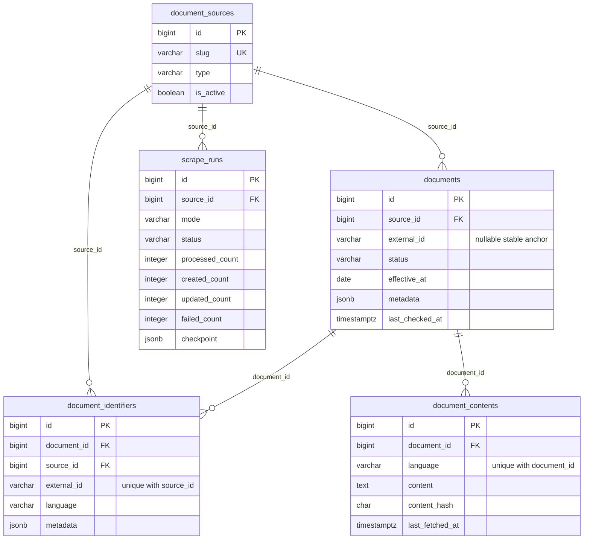

# P1 — Laravel 13 Foundation & Database Architecture

**Sana:** 2026-10-28, Asia/Tashkent. **P1: bajarildi. P2: texnik GO, foydalanuvchining aniq tasdig'i kutiladi. Full import: NO-GO.**

Yangi Laravel foundation noldan yaratildi. Foydalanuvchining aynan P1 topshirig'ida tasdiqlangan A/B/C qarorlari bajarildi. P0/P0.1 live testlari takrorlanmadi; P1da Lex.uz'ga **0 request**. Saved fixture va test natijalari o'qildi, PHP testlarida ishlatildi. Oldingi application kodi mavjud emas edi va ishlatilmadi.

## 1. Environment va bazalarni ajratish

| Komponent | Haqiqiy natija |
|---|---|
| PHP CLI | **8.5.11**, `/usr/bin/php8.5` |
| Laravel framework | **13.39.0**, official `laravel/laravel` 13 skeleton |
| Composer | **2.8.5** |
| PostgreSQL server/client | **17.11** |
| PHPUnit | **12.5.42** |
| DomCrawler / CSS Selector | **8.1.5 / 8.1.6** |
| Symfony Process | **8.1.9** |
| Local DB host/port | `127.0.0.1:5432`, `pgsql` |
| Foundation database | `mening_fikrim_p1` — yangi, alohida |
| Test database | `mening_fikrim_p1_test` — yangi, alohida |
| Timezone / queue / cache | `Asia/Tashkent` / `database` / `database` |

Paketlarning aniq locked versiyalari [environment.json](p1/environment.json) va [composer.lock](../composer.lock)da. PHP `~8.5.0` talabi Composerda belgilandi. `pdo_pgsql`, `curl`, `dom`, `mbstring`, XML, fileinfo, openssl va zarur kengaytmalar mavjud; [platform check](p1/platform_check.txt) o'tdi. Laravel 13/PHP 8.5 mosligi [rasmiy release policy](https://laravel.com/framework/docs/releases) bilan ham tekshirildi.

Avvalgi `mening_fikrim_active` bazasiga migration/test/import yozuvi bajarilmadi. Uning public table inventorysi oldin ham, keyin ham 0; [before](p1/database_before.json), [after](p1/database_after.json). P1 bazasida faqat 2 source seed, documents/identifiers/contents/runs/jobs = **0** qoldi. Fixture importlar faqat test bazasida bajarilib, migration test lifecycle'i bilan tozalandi. Test suite bir xil test bazasida parallel suite sifatida ishga tushirilmasligi kerak.

Haqiqiy credential va APP_KEY faqat ignored, mode `0600` `.env`/`.env.testing`da. `.env.example` va `.env.testing.example`da credentiallar bo'sh. TASKSdagi avvalgi plaintext credentiallar olib tashlandi. Test bootstrap dedicated `_test` nomini, actual PostgreSQL connectionni va DB_URL yo'qligini migrationsdan oldin tekshiradi.

## 2. Migrations va ERD

**7 migration fayli** haqiqiy P1 PostgreSQL bazasiga muvaffaqiyatli qo'llandi: [migrate output](p1/migration_output.txt), [yakuniy status](p1/migration_status.txt). Testda 5 biznes migration rollback qilinib, yana qo'llandi.

| Migration | Natija |
|---|---|
| `0001_01_01_000001_create_cache_table` | `cache`, `cache_locks` |
| `0001_01_01_000002_create_jobs_table` | `jobs`, `job_batches`, `failed_jobs` |
| `2026_10_28_000001_create_document_sources_table` | UNIQUE slug, scraper/manual CHECK |
| `2026_10_28_000002_create_documents_table` | source FK, stable nullable anchor, JSONB, status CHECK, rolling/status-date indekslari |
| `2026_10_28_000003_create_document_identifiers_table` | source+external UNIQUE, document index, source FK, composite document/source FK |
| `2026_10_28_000004_create_document_contents_table` | document FK, document+language UNIQUE, TEXT Markdown, SHA-256 CHECK |
| `2026_10_28_000005_create_scrape_runs_table` | mode/status/counters/strict-completion CHECK, JSONB checkpoint, source/status va started_at indekslari |

Jami **5 biznes jadval**. Laravel migration registry, queue/cache jadvallari biznes jadvali emas. Users/auth yoki boshqa biznes jadval yaratilmadi. Faqat so'ralgan 4 run counter saqlandi: processed, created, updated, failed. Eski PLANdagi discovered/queued/unchanged ustunlari yangi P1 schema topshirig'iga mos ravishda qo'shilmadi.

Composite FK uchun `documents(id, source_id)` unique constraint qo'shildi; bu yangi biznes field/jadval emas. Bir source identifieri boshqa source documentiga bog'lanishi DB darajasida rad etiladi. Source o'chirilishi referenced rowlar bo'lsa restricted; document o'chirilsa o'z identifiers/contentslari cascade bo'ladi. Bu referential behavior testlandi; importer hujjatlarni o'chirmaydi.

## 3. Implementatsiya qilingan qismlar

- `app/Models/DocumentSource`, `Document`, `DocumentIdentifier`, `DocumentContent`, `ScrapeRun`: HasMany/BelongsTo relationships, JSONB/boolean/immutable date casts. `DocumentStatus` faqat active/pending/inactive, shu nomli scopes.
- `app/Services/Documents/DocumentValidator`: portable identity proof, source metadata status/date, language content admission, partial text/page/OCR/shrinkage guardlari; review validation natijasi.
- `app/Services/Documents/DocumentImporter`: identifier lookup, source lock, transaction, independent language writes, stable anchor/hash, conflict va stale-result protection.
- `app/Jobs/ImportDocumentJob`: database queue'da tayyor internal candidate saqlaydi; timeout/tries konfiguratsiyadan, after-commit dispatch. Incomplete result validation exception sifatida ochiq qoladi; valid tillarning committed natijasi saqlanadi.
- `config/scraping.php`, queue/app/filesystem konfiguratsiyasi, `.env` examplelar, idempotent `DatabaseSeeder` (`lex`, `manual`).
- PHPUnit bootstrap/fixtures, 3 PostgreSQL feature test classi, 1 validator test classi, concurrency child process.
- [README](../README.md), [IMPORT_CONTRACT](IMPORT_CONTRACT.md), [PLAN](LEX_SCRAPING_PLAN.md), [TASKS](LEX_SCRAPING_TASKS.md), ushbu hisobot va [dalillar](p1/). To'liq fayl inventorysi: [files.json](p1/files.json).

Universal modellar/importer ichida Lex.uz selector/label/ID qoidalari yo'q. `tests/Fixtures/FixtureInputs.php` saved kartochka/Markdownni test contractiga normalizatsiya qiladi; u production parser emas. PDF/OCR tools P1da ishga tushirilmadi. Keraksiz frontend assetlari, users/auth migration va scaffold agent installer olib tashlandi; Boost/AI dependency qo'shilmadi.

`DocumentScraper`, `LexUzScraper`, `LexUzParser`, `DiscoverDocumentsJob`, `SyncDocuments` hozir yozilmadi: foydalanuvchining 7/10-bandlaridagi foundation-only qoidasiga ko'ra, keyingi bosqich logic'ini fake placeholder bilan to'ldirmadik. Schedulerda **0 event**; web routesda faqat standart `/up` health route bor. [Scheduler](p1/schedule_list.txt), [route inventory](p1/route_list.txt). Discovery va live sync komandasi mavjud deb ko'rsatilmaydi.

## 4. Importer ishlash tartibi

1. Internal candidate identity graph va source status/date evidence tekshiriladi; noma'lum yoki ichki zid metadata yozuvdan oldin rad etiladi. Sana clock parametriga bog'liq, serverning real sanasiga emas.
2. Source row `FOR UPDATE` lock olinadi. Shu source identifiersi va canonical anchor bo'yicha mavjud document aniqlanadi. JSONB alias lookup ishlatilmaydi.
3. Reciprocal source links va matching requisites bilan connected/closed component talab qilinadi. Ikki mavjud documentga urilish yoki persisted proof bilan ziddiyat avtomatik merge qilinmaydi. Optional publication yo'qligi haqiqiy ikkita zid sanani yashira olmaydi.
4. Yangi document faqat active/pending va kamida bitta valid full text bilan yaratiladi. Yangi component lexical opaque anchor oladi; mavjud anchor yangi tillarda o'zgarmaydi. Universal identity `documents.id`.
5. Har full-text til alohida validate qilinadi. Validlari saqlanadi; invalid/missing til eski matnini bosmaydi. Metadata-only identifier saqlanishi mumkin, lekin tarjima xabari contentsga yozilmaydi.
6. Newline-normalized Markdown SHA-256 bilan changed/unchanged hisoblanadi. Har tilda latest bitta row; tarixiy tahrir jadvali yo'q. Barcha required full-text tillar valid bo'lsagina `last_checked_at` yangilanadi.
7. Valid source metadata status/date partial content natijasida ham yangilanishi mumkin; content quality mustaqil. DB/infrastructure xatosi esa document, identifier va barcha content yozuvlarini to'liq rollback qiladi.

Portable input, qaytariladigan natija va muhim chegaralar [IMPORT_CONTRACT](IMPORT_CONTRACT.md)da. Source bo'yicha lock ataylab sodda: bir source writerlari ketma-ketlashadi. Katta corpus throughputi yoki ko'p worker samaradorligi P1da o'lchanmadi.

## 5. Haqiqiy test natijalari

Yakuniy `composer test -- --colors=never --log-junit docs/p1/junit.xml`:

**46 passed, 187 assertions; errors=0, failures=0, skipped=0.** CLI davomiyligi **9.81 s**, JUnit suite vaqti **9.694817 s**. 35 feature va 11 validator testi. Dalillar: [terminal output](p1/test_output.txt), [JUnit](p1/junit.xml), [summary](p1/summary.json). Pint check va Composer strict validation o'tdi; Composer auditda advisory aniqlanmadi.

| Tekshiruv | Haqiqiy dalil / natija |
|---|---|
| Schema, FK, JSONB, constraints | PostgreSQL actual schema; 5 biznes jadval; source/identifier/content FK va unique violationlar 23503/23505, status/review va completion CHECK 23514 |
| Models/scopes | Besh model relationships; enum va immutable date/JSONB casts; active/pending/inactive scopes o'tdi |
| Canonical identity | Saved 4 graph / 15 source ID generic validator bilan o'tdi. Bitta `8506802` component importi **1 document / 4 identifier / 3 full-text**: en, uz-Cyrl, uz-Latn; RU metadata-only |
| Idempotence | Barcha 4 entrypoint o'sha documents.id va anchorni ishlatdi; takroriy unchanged, duplicate yo'q. CRLF/JSONB object order biznes change emas |
| Source namespace | Ikki source'dagi bir xil external IDlar alohida documentlar; bir source ID ikki documentga yozilmaydi |
| Fail-closed | One-way/missing/disconnected graph, mismatching requisites, ikki mavjud documentga mapping, persisted proof conflict va omitted old identifiers rad etildi |
| Parallel race | **2 haqiqiy PHP process**, PostgreSQLda **2 lock waiter** kuzatildi. Lock ochilgach **created + unchanged**, 1 document / 4 identifier / 3 content. [concurrency.json](p1/concurrency.json) |
| Rollback | Ikkinchi til insertida controlled persistence exception: hammasi 0 row. Alohida haqiqiy PostgreSQL trigger exception `P0001` ikkinchi til update'ida: oldingi document/identifiers/contents snapshoti to'liq saqlandi |
| Mustaqil tillar | English failure holatida 2 haqiqiy Uzbek variant saqlandi; **complete=false**; keyingi successful retry 3-content bilan complete bo'ldi. Bu fixtureda RU full text bo'lmagani uchun 4 til saqlangani da'vo qilinmaydi |
| Old good text | Missing/partial/shrunken/bad OCR ingliz yoki kirill matnini bosmadi; boshqa valid til yangilandi; `last_checked_at` avvalgicha qoldi |
| Hash / latest | Matn o'zgarsa hash va ayni content row yangilanadi; yangi history row yo'q |
| Pending/active/inactive | Fixed clock bilan pending → active, Tashkent yarim tuni chegarasi, source revoked → inactive; content hashlar saqlandi; N future metadata pending deb taxmin qilinmadi |
| Metadata/PDF ustuvorligi | Actual `-8553692` source card sanasi **2026-10-23** DBda saqlandi, **active**, body **2027-01-01** warning; OCR review mustaqil qolib eski matnni bosmadi |
| Quality guard | Saved PDF/OCR quality review, page mismatch va uncertified OCR rad etildi. Yaxshi status bad extractionni valid qilmaydi |
| Strict Completion | Required til missing/invalid bo'lsa document verification incomplete. Run uchun 5 gate va failed_count=0 shart; direct SQL ham yetishmayotgan gate bilan completed yozolmaydi |
| Queue | Haqiqiy database queue after-commit dispatch, rollbackda orphan job yo'q; bitta offline queued fixture job pop/fire bilan bajarildi. Incomplete job failure sifatida ochiq qoldi |

`-8553692` safe-update testidagi **oldingi yaxshi matn controlled synthetic test state**: haqiqiy OCR certified deb ko'rsatilmagan. Xuddi shunday yangi `fr` identifier bilan anchor testi controlled input; Lex.uz'da haqiqiy French tarjima topilgani da'vo qilinmaydi. 4 graph testi 4 hujjatning barcha parsing sifatidan o'tganini anglatmaydi: murakkab graph fixturelar faqat identity uchun ishlatildi.

### Dastlab uchragan, tuzatilgan xatolar

- Birinchi suite: 37 testning barchasida test harness noto'g'ri `http` container aliasidan foydalangani sabab bootstrap error. Laravel HTTP Client Factory binding bilan tuzatildi.
- Ikkinchi suite: 37 testdan 9 tasida PostgreSQL JSONB object key order strict PHP array comparisonda false requisites conflict berdi. Strict scalar types va ordered listlarni saqlaydigan structural object comparison bilan tuzatildi; metadata change detection ham shu usulga o'tdi.
- Keyingi suite 38/38 o'tdi; so'ng meaningful race/rollback/status/quality regressionlar qo'shilib yakuniy 46/46 o'tdi. [Development natijalari](p1/development_test_results.json); dastlabki output/JUnit fayllari ham `p1/`da saqlangan. **Hozir ochiq failing test yo'q.**

## 6. Konfiguratsiya va Strict Completion chegarasi

Request delay **2000 ms**, HTTP/PDF timeout **30/90 s**, tries **3**, job timeout **900 s**, queue retry_after **960 s**, recheck **90 kun**, daily time **02:00**. Queue retry_after job timeoutidan kichik/teng bo'lsa application boot rad etadi. HTTP client frameworkniki; Symfony DomCrawler/Process dependencies installed. Bu config P1da real rate limiter yoki live parser ishlaganini anglatmaydi.

`ScrapeRun::canComplete()` va DB CHECK checkpointdagi coverage/discovery/jobs/languages/quality gate'larini tekshiradi. **P1 orchestration yoki counter reconciliation'ni implementatsiya qilmaydi**: ushbu gate'larning haqiqiy dalilini keyingi orchestrator hisoblaydi. Importer/job runni avtomatik completed qilmaydi; queue bo'shligi bilan coverage tasdiqlanmaydi. Shu sabab P1 completed holati global Lex.uz corpus completed degani emas.

## 7. Qolgan cheklovlar va keyingi bosqich

- Production HTTP adapter, status label normalization, HTML → Markdown parser va PDF/OCR pipeline hali yo'q; saved fixture quality evidence internal contract orqali qabul qilinadi. Parser uning rostligini keyingi bosqichda isbotlashi kerak.
- P0.1dagi qolgan **13 review**, global discovery coverage, PDF language aliaslari, complex table/image/OCR aniqligi va bulk access masalalari bu bosqichda yopilgani yo'q. P0/P0.1 natijalari qayta live tekshirilmadi.
- 30% shrinkage — konservativ interim protection; optimal production threshold deb tasdiqlanmadi. OCRning hujjat darajasidagi certification jarayoni hali kelishilmagan. Thresholdni pasaytirib full importga o'tilmadi.
- Discovery checkpoint/resume, retry/backoff/429 behavior, queue run ledger/reconciliation, live scheduling va 1000 hujjat stress/integration hali bajarilmagan. Manual identifiersiz authoring oqimi ham keyinroq.
- Test concurrency bitta source/bitta identitydagi ikkita writer uchun real dalil; butun corpusning performance benchmarki emas. Semantik identity tekshiruvi uchun barcha writerlar importer protokoliga rioya qilishi kerak.
- Composer 2.8.5 PHP 8.5da deprecation notice chiqardi; install/validate/platform/audit muvaffaqiyatli. Toolingni yangilash mumkin, bu foundation testlarini bloklamadi. [Audit](p1/composer_audit.txt).

PLAN va TASKSga faqat yangi topshiriq tasdiqlagan A/B/C hamda aynan P1 scope kiritildi. P0/P0.1 tarixiy hisobotlari va **184 ta fixture fayli hash bo'yicha o'zgarmadi**. Qolgan P0.1 takliflari blanket approval deb olinmadi. Eski P2 schema/model va P4 importer foundation vazifalari yangi foydalanuvchi P1 topshirig'iga ko'chirilgan; bu P2 yoki undan keyingi bosqichni boshlash emas.

**P2 — GO:** Laravel/PostgreSQL/importer foundation keyingi alohida tasdiqlangan development scope uchun tayyor. Eski P2 schema vazifalari P1da bajarilgani sabab keyingi topshiriqda P2 scope aniq ko'rsatilishi kerak. **Full import — NO-GO:** quality/coverage/orchestration/integration gate'lari ochiq va alohida ruxsat talab etiladi.

P1 yakunida ish to'xtatildi. P2 yoki boshqa bosqich foydalanuvchining yangi aniq tasdig'isiz boshlanmaydi.
