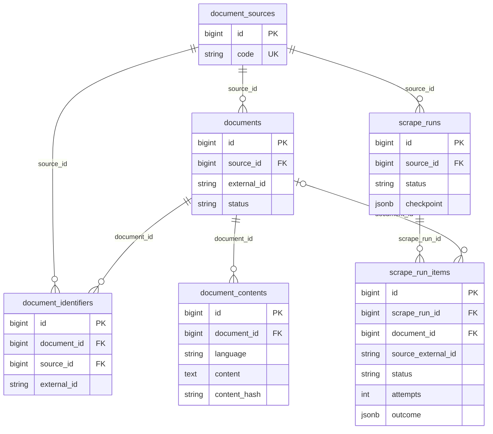
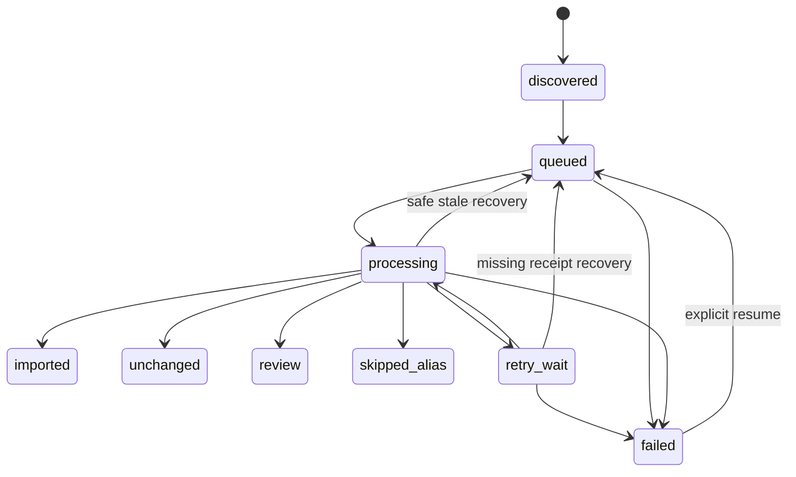

# P3 — Scraping Quality, Durable Tracking & Performance

2026-10-28, Asia/Tashkent. Muhit: Laravel **13.39.0**, PHP **8.5.11**, PostgreSQL **17.11**, PHPUnit **12.5.42**. Ushbu hisobot P3ning haqiqiy local PostgreSQL, offline fault/benchmark va cheklangan Lex.uz testlarini ajratadi. Dalillar katalogi: [p3/README](p3/README.md).

## A. Executive Summary

P3 bajarildi. Oltinchi biznes jadval `scrape_run_items`, durable queue receipt/lease/recovery, normal quality review va texnik failure ajratilishi, inclusive adaptive discovery, HTML table/heading guardlari, PDFning yetti acceptance darajasi va OCR diagnostikasi qo'shildi. Universal importer/validator va identity asoslari qayta yozilmadi.

**Natija:** 16 distinct canonical guruh / 19 tanlangan source ID. Shundan 3 guruh barcha zarur tillari bilan valid: 2 oldingi active guruh qayta tekshirildi va **1 yangi haqiqiy pending guruh** 3 til bilan import qilindi. Majburiy eski 13 reviewning barchasi qayta tekshirildi va yetarli sifat dalili bo'lmagani uchun reviewda qoldi. Bu tanlov asosan eng qiyin hujjatlardan tuzilgan; P2ning 30 guruhdagi 17 valid natijasi bilan acceptance foizini bevosita solishtirib bo'lmaydi.

| Yakuniy ko'rsatkich | Haqiqiy natija |
|---|---:|
| Avtomatik regression | **110 test / 443 assertion**, 0 failure/error/skipped |
| Live so'rovlar | **289**, barchasi HTTP 200; budget 400 |
| Minimal live request start intervali | **2.000021697 s**, 1 worker |
| Asosiy formatlar, 16 guruh | **10 HTML / 6 text-layer PDF** |
| Qo'shimcha haqiqiy scan rendition | 2 PDF, **36 OCR sahifa** |
| Unique PDF sahifalar | **101**: 65 text-layer + 36 scan |
| Yakuniy qayta import, run 7 | 3 unchanged / 13 review / 3 skipped_alias / 0 technical failed |
| Development DB | **16 documents / 48 identifiers / 40 contents** |
| Queue / tarixiy failed jobs | **0 jobs / 24 eski failed_jobs**, yangi P3 live failed job 0 |

Global coverage, PDF reading order/table/language certification, document-level OCR accuracy, haqiqiy server rate limit va katta corpus sinovi ochiq. **P4: CONDITIONAL GO; 1000 integration: NO-GO; full import: NO-GO.** Bu keyingi bosqichga ruxsat emas. P4, 1000 va full import boshlanmadi; scheduler o'chirilgan.

## B. Database

Development doim `mening_fikrim_active`, test doim `mening_fikrim_active_test`. Yangi database yaratilmadi. Boshqa mavjud bazalarning table inventory/countlari saqlandi; bu ularning barcha rowlari uchun byte-level hash auditi degani emas. Developmentda `migrate:fresh` ishlatilmadi. Destructive regression faqat actual connection nomi tekshirilgan test bazasida bajarildi.

### Olti jadvalli ERD

Framework `jobs`, `failed_jobs`, `job_batches`, `cache`, `cache_locks`, `migrations` biznes jadval hisobiga kirmaydi. Boshqa yangi biznes jadval qo'shilmadi.

### Migration va minimal texnik fieldlar

Yangi migration: [`2026_10_28_000006_create_scrape_run_items_table.php`](../database/migrations/2026_10_28_000006_create_scrape_run_items_table.php). Developmentda batch 2; jami **8 migration Ran**. Test bazasida ham 8 Ran. [Development status](p3/development_migration_status.txt), [test status](p3/testing_migration_status.txt).

So'ralgan fieldlar saqlandi. Qo'shimchalar:

| Field | Sabab |
|---|---|
| `listing_status` | Listing corroborationni metadata/status resolutionga yetkazish |
| `action`, `outcome` JSONB | Created/updated/unchanged va yakuniy proofni retry/counter bilan yarashtirish |
| `discovery_signatures` JSONB | Leaf va ancestor interval source-ID union reconciliation |
| `queue_job_id` | Atomik queue receipt; job normal o'chishi sabab jobs jadvaliga FK emas |
| `dispatch_token` | Eski/stale worker yozishini to'suvchi dispatch fence |
| `available_at`, `lease_expires_at` | Delayed retry va tugamagan processingni xavfsiz recovery qilish |

UNIQUE `(scrape_run_id, source_external_id)`, FK run→cascade/document→restrict, `(run,status)` va `(run,document)` indekslari, processing lease uchun partial index bor. CHECKlar statuslar ro'yxati, attempts≥0, terminal timestamp va accepted/alias uchun document IDni majbur qiladi. Opaque ID string: `8506802` va `-8506802` alohida item; `abs(id)` yoki integer normalizatsiyasi yo'q.

P2ning uch runidagi **55 item** JSONB checkpointdan ledgerga ko'chirildi. Checkpoint version 3 bo'ldi; per-item `items/outcomes` olib tashlandi. Eski `failed_count` quality reviewni sanagan bo'lsa, u `legacy_failed_count` va old checkpoint SHA-256 bilan saqlandi; yangi `failed_count` faqat technical failed itemlar. Run boshlanish/tugash vaqti, document/content/identifier IDlari va eski 24 failed job o'zgarmadi. [Migration preservation audit](p3/migration_audit.json).

### Lifecycle va transaction consistency

Terminal accepted/review/alias natija o'z-o'zidan yana processingga o'tmaydi. Reviewni qayta tekshirish uchun yangi bounded run kerak. Attempts — haqiqiy processing claimlari jami; Laravel attempts bitta dispatch retry epizodiga tegishli. Failed resume yangi token/epizod beradi, cumulative attempts saqlanadi.

Discovery item + queue insert + receipt + checkpoint bitta transactionda. Fetch/HTML/PDF/OCR source transactiondan tashqarida. Commit paytida run→item→source qisqa lock tartibi, universal importer va terminal outcome/counter bir transactionda. Partial texnik til xatosida yaxshi tillar saqlanadi, texnik xato retry uchun qayta tashlanadi; created action keyingi retryda yo'qolmaydi.

Strict Completion app darajasida discovery/coverage/jobs/languages/quality, pending framework jobs va ledgerni tekshiradi. Qo'shimcha deferred PostgreSQL constraint trigger `completed` run bilan unresolved item, `complete=false` outcome yoki processed counter mismatchni commitda rad etadi. Trigger butun source coverage isbotining o'rnini bosmaydi. Run enumlari o'zgarmadi.

Yakuniy barcha 7 run bo'yicha **112 item**: imported 18, unchanged 22, review 63, skipped_alias 9, failed/open/retry 0. Bu tarixiy va takroriy runlar yig'indisi; 112 distinct hujjat degani emas. 55 legacy + 57 P3 item. `pg_column_size` maksimumi: checkpoint **1609 byte**, item outcome **239837 byte**; bu JSONning uncompressed uzunligi emas. Katta corpusda table/region diagnostika hajmi, ancestor JSON query va indekslar real profiling talab qiladi; GIN hozir qo'shilmadi.

### Mavjud matnlarni saqlash

Migration oldingi **15 document / 45 identifier / 37 content**ni aynan saqladi. P3 live oxirida 16/48/40 bo'ldi: 1 yangi pending document va 3 yangi content. Oldingi 37 contentdan **34 tasi aynan o'zgarishsiz**, 3 Mehnat kodeksi variantida faqat bittadan bo'sh `##` olib tashlandi. O'sha `## \n\n`ni joyiga qaytarish P2 SHA-256ni aynan tikladi; normativ matn qisqarmagan. Uch tilda modda headinglari **593** saqlandi; barcha 40 contentda bo'sh heading 0.

Run 5dan yakuniy run 7gacha **40 content ID/hashning barchasi aynan teng**, 0 create/update. Eski 24 failed jobning to'liq row hash auditi teng. [Content audit](p3/content_audit.json), [idempotence](p3/final_idempotency.json), [database audit](p3/database_after.json).

## C. Queue & Quality Review

P2da oddiy quality review RuntimeException sifatida failed_jobsga tushgan edi. Endi uch natija aniq ajratilgan:

| Natija | Item / queue harakati |
|---|---|
| Accepted | `imported` yoki `unchanged`; valid tillar commit, normal success |
| Review Required | `review_reasons`, `language_results`, quality proof durable; normal success, retry yo'q, Strict Completion false |
| Technical Failure | HTTP/process/DB/filesystem yoki unexpected parser exception; backoff/retry; exhausted → failed item va texnik failed job |

Kutilgan source uncertainty `SourceReviewException` bilan normal reviewga aylanadi. Kutilmagan exception yutilmaydi. Parserning bir required tilida texnik xato bo'lsa, boshqa valid tillar commit bo'lishi mumkin, ammo item complete emas va texnik retry saqlanadi. Invalid yangi text eski yaxshisini bosmaydi. Prepared-array P1 import API ishlaydi; uning incomplete natijasi ham alohida durable prepared-candidate review sifatida qayd etiladi.

Verified alias faqat ayni run ichida qabul qilingan canonical groupga ishonchli identity orqali bog'langanda skip qilinadi. Oldingi bazada mapping borligining o'zi yangi run tekshiruvini o'tkazib yuborish uchun yetarli emas. Live run 7da `8506802`, `-8506802`, `8506870`, `8507863`: 4 source ID / 1 canonical group, 1 unchanged + 3 alias skip.

Processing lease **930 s**, job timeout **900 s**, queue retry_after **960 s**. Active lease/reservation oldindan qaytarib olinmaydi. Retryda Laravel jobs.idni almashtirsa ham dispatch token receiptni topadi; resume ikkinchi delayed job yaratmaydi. Stale/missing processing explicit resume bilan tiklanadi; eski token yozuvi fence qilinadi. Framework `queue:failed` tarixiy ro'yxati quality review hisoblagichi emas.

Real graceful restart: run 6da birinchi importdan so'ng `queue:restart`; worker “Received restart signal” bilan chiqdi. Qolgan **18 job**, **19 item**, receipt/token/statuslar resume oldi/keyin teng; ayni run davom etdi. [Resume audit](p3/resume_audit.json), [restart terminal](p3/queue_restart_terminal.txt). Bu graceful restart dalili; host power-loss testi emas.

Controlled tests duplicate delivery, 3 urinishda unexpected parser exhaustion, delayed retry receipt, commit-boundary exception rollback, stale lease/token fencing va partial-language technical retryni tekshirdi. Ikki real PG process bitta opaque item/bitta queue receiptga converge qildi; source importer race ham qayta o'tdi. Alohida ikki-worker fake HTTP alias sinovi: 3 source ID / 1 document / 1 created / 2 skipped_alias, technical 0. [Parallel alias evidence](p3/parallel_alias.json).

CLI read-only: `php artisan documents:sync lex --report=7`, `--items=7 --status=review`. Run summary source ID, canonical/stored group, ledger holatlari, framework jobs, required language failure, duration va gate'larni alohida ko'rsatadi. Run 7da required-language failure **20**, review group **13**: bular turli qamrov, qo'shib sanalmaydi. Initial inactive admissionda til natijalari yaratilmasligi ham alohida qayd etilgan.

## D. Parser Quality

### Majburiy 13 review: P2 → P3

Quyidagi barcha URLlar haqiqiy source request bilan qayta tekshirildi. Har birining batafsil til natijasi va xato sababi [review_comparison.json](p3/review_comparison.json)da.

`PDF U` = reading order, table/section structure, physical language coverage va image semantics yetarlicha tasdiqlanmagan. P2dagi qisqa `structure/language` sabablarining P3da mayda ajratilishi sifat yomonlashganining dalili emas.

| Source URL | P2 natijasi | P3 yangi holati va ochiq sabab |
|---|---|---|
| [8548754](https://lex.uz/uz/docs/8548754) | HTML review: images | **pending / review**; huquqiy mazmunli rasm ajratilmagan |
| [8554309](https://lex.uz/uz/docs/8554309) | HTML review: complex table | **active / review**; cell/coordinate/span olindi, semantika tasdiqlanmagan |
| [-7655343](https://lex.uz/uz/docs/-7655343) | HTML review: complex table | **active / review**; 4 til olindi, murakkab jadval barcha variantda review |
| [-8540314](https://lex.uz/uz/docs/-8540314) | HTML review: table/image/math | **active / review**; shu uch cheklov saqlanadi |
| [-8102878](https://lex.uz/uz/docs/-8102878) | HTML review: table/math | **inactive / review**; initial admission faqat active/pending; table/math ham ochiq |
| [8557098](https://lex.uz/uz/docs/8557098) | PDF review: structure/language | **pending / review, PDF U**; p9 9×5 jadval fixture o'tdi, document-level proof emas |
| [8554315](https://lex.uz/uz/docs/8554315) | PDF review: structure/language | **pending / review, PDF U** |
| [8554432](https://lex.uz/uz/docs/8554432) | PDF review: structure/language | **active / review, PDF U**; final fresh kartochka tili tanildi |
| [8554353](https://lex.uz/uz/docs/8554353) | PDF review: structure/language | **active / review, PDF U**; final fresh kartochka tili tanildi |
| [8554326](https://lex.uz/uz/docs/8554326) | PDF review: structure/language | **active / review, PDF U** |
| [8554321](https://lex.uz/uz/docs/8554321) | PDF review: structure/language | **active / review, PDF U** |
| [-8553258](https://lex.uz/uz/docs/-8553258) | OCR review: confidence/script/certification | **active / HTML review: complex table**; source asosiy formatini o'zgartirgan. Alternate 17-page scan OCR ham uncertified |
| [-8553692](https://lex.uz/uz/docs/-8553692) | OCR review: confidence/script/certification | **pending / HTML review: complex table**; yangi metadata 2027-01-01. Alternate 19-page scan OCR ham uncertified |

13/13 qayta baholandi, 0 tasi isbotsiz valid qilindi. So'nggi ikki holatda OCR→HTML almashishi parser yutug'i emas, **source o'zgarishi**. P2ning `-8553692` kartochkasida 2026-10-23 edi; P3da effective date 2027-01-01. Yangi rasmiy metadata ustuvor; IDga tarixiy sanani hardcode qiladigan istisno yo'q. [Source metadata/identity snapshots](p3/source_changes.json), regression test: `test_new_real_metadata_is_not_forced_to_the_old_p2_effective_date`.

### HTML

Bo'sh headinglar olib tashlandi. Jadval bevosita row/celllari recursive ajratiladi; nested rowlar tashqi tablega qayta qo'shilmaydi. Occupied-grid coordinate, rowspan/colspan va cell text inventory saqlanadi. Complex Markdown `[T1:R1C1;rowspan=…;colspan=…]` kabi loss-aware marker oladi. Generated markerlar token-fidelity hisobidan chiqariladi; nested jadval matni ikki marta chiqarilmaydi. Bu ma'lumotni saqlashni kuchaytiradi, lekin header/cell huquqiy munosabatini avtomatik tasdiqlamaydi.

Numeric superscript, bob/modda/band va oddiy jadval regressionlari o'tdi. Matematik superscript, image/diagram va complex table reviewdan chiqarilmadi. Cleanup normativ headingni qamrasa flag qo'yiladi; removed-char diagnostikasi mavjud. Bob/modda/ilovalarni barcha corpusda satrma-satr manual tekshirish bajarilmadi. Markdown authoritative text bo'lib qoldi, documentdan tashqari UI HTML saqlanmadi. Timing diagnostikasi content metadata/hashga qo'shilmaydi.

### PDF: yetti alohida daraja

| Daraja | P3 dalili / cheklov |
|---|---|
| 1. Bytes valid | Content-Type va `%PDF`, bounded download |
| 2. Page accounting | Expected/extracted page va page boundary, 101 unique page |
| 3. Text extraction | Text layer yoki page-level OCR natijasi, script/geometry signallari; bu accuracy sertifikati emas |
| 4. Reading order verified | Multi-column/out-of-page bbox suspicion bor; umumiy tasdiq **yo'q** |
| 5. Table/section verified | Cell/bbox diagnostikasi bor; butun hujjat structure **tasdiqlanmagan** |
| 6. Language coverage verified | Physical script tekshiriladi; barcha mavjud PDF tarjimalari **isbotlanmagan** |
| 7. OCR accuracy verified | Confidence/gold/provenance bor; document-level certification **yo'q** |

Dastlabki ikki/uch level butun PDFni valid qilmaydi. PDF page boundary saqlanadi; plain textdan legal heading/annex/orderni universal tiklash da'vosi yo'q. PDF global UI language menyusi tarjima isboti sifatida olinmaydi. Bir xil bytesni turli label bilan qayta saqlashga asos yo'q; physical `uz-Cyrl` va declared `uz-Latn` mismatch ochiq qoladi.

Optional Python Process yordamchisi: **pdfplumber 0.11.10**, tolerance 3 va 8, table cell/bbox/settings-disagree diagnostikasi. Bu PHP/Laravelni almashtirmaydi; qo'shimcha Python dependency va CPU/memory xarajati bor. Local P3da yoqilgan; example default false. Kutubxonaning o'zida ham table extraction sozlamalari hujjat layoutiga bog'liq: [primary pdfplumber source](https://github.com/jsvine/pdfplumber).

Fresh `8557098` p9da tolerance 3 **11×11**, tolerance 8 **9×5** chiqardi. Ikkinchisining **45 cell qiymati P0.1 reference bilan aynan teng**; sahifa renderi ham ko'rildi. Settings disagree bo'lgani uchun table_relationships_verified=false va butun PDF review. [Table regression](p3/pdf_table_regression.json).

### OCR, gold va provenance

Joriy HTML ichidagi haqiqiy download link → `/uz/pdfs/{id}` viewer → PDFObject resource oqimi orqali alternate scanlar topildi: [17-page PDF](https://lex.uz/pdffile/-8553258), [19-page PDF](https://lex.uz/pdffile/-8553692). Resource URL taxmin qilinmadi. Poppler raster, Tesseract **5.3.4**, `uzb_cyrl+uzb`, 200 DPI/max2400px bilan real 36 page OCR bajarildi. Rus/ingliz tabiiy scan corpus accuracy P3da sinalmadi; ularning modeli borligi certification emas.

Har page confidence, low-confidence fraction, physical script, critical metadata date/number tokens, TSV hash/model/raster, source PDF SHA/Markdown SHA va suspicious word bboxlar bor. Region sample har page≤200, total/truncated alohida. 17-page PDFda **111 region**, mean confidence **81.4993–95.4721**; 1 page mean<90, 2 page low-fraction>5%. 19-page PDFda **27 region**, mean **91.5985–96.0514**; 0 page mean<90, 1 page low-fraction>5%. Sample truncation 0. Line-height/outsize bbox hintlari mavjud, **missing/merged line aniqligi isbotlanmagan**. Sana yozuv shakli farq qilsa literal critical-token tekshiruvi konservativ review beradi.

| P0.1 manual gold, fresh P3 OCR | Normalized reference chars | CER | WER | Qamrov |
|---|---:|---:|---:|---|
| `-8553692`, p1, 4-band | 52 | **0** | **0** | Faqat bitta excerpt |
| `-8553258`, p17, 39-band | 105 | **0.0190476** (2 char) | **0.0769231** (1 word) | Faqat bitta excerpt |

Ikkinchi excerptda “талабларининг” so'zining 2 harfi yo'qolgan. Punctuation/whitespace normallashgan; jadval raqamlari raw transcription accuracy bilan tenglashtirilmaydi. Uch real sahifa (jadval p9 va ikkala gold sahifa) ko'z bilan render orqali tekshirildi; butun 101 sahifani manual certification qilish bajarilmadi.

Region diagnostikasi ayni fresh baytlarda offline qayta bajarildi, Markdown SHA aynan teng. Replay driverida negative numeric key PHP integerga aylangani sabab bitta excerpt uchun noto'g'ri regex tanlangan edi; bu matcher xatosi tuzatildi. Original Markdown hash tekshirilib, excerpt aynan qayta ajratildi; yangi OCR o'lchovi deb ko'rsatilmadi. [Gold reconciliation](p3/gold_reconciliation.json), [region diagnostics](p3/ocr_regions_real.json), [OCR summary](p3/ocr_summary.json). Confidence accuracy bilan teng emas; thresholdlar pasaytirilmadi, ikkala scan uncertified review.

**Manual certification taklifi, hali implementatsiya emas:** reviewer/date, source URL/PDF SHA, Markdown SHA, parser/Poppler/Tesseract/model/raster versiyasi; barcha sahifa/reading-order, table/annex/image va language tekshiruvi; huquqiy critical sana/raqam/band, gold CER/WER va issue/evidence havolalari bilan audit yozuvi. Source hash o'zgarsa eski sertifikat qayta tekshirilsin. Saqlash shakli va approval siyosati alohida kelishiladi; yangi jadval, frontend yoki auto-promote qo'shilmadi.

### Haqiqiy pending import

Real query: [nat, Y, from_eff 29.10.2026–31.12.2027](https://lex.uz/uz/search/nat?status=Y&from_eff=29.10.2026&to_eff=31.12.2027), source total **185**, faqat birinchi 20 row ko'rildi. [Discovery evidence](p3/pending_discovery.json).

[8548643](https://lex.uz/uz/docs/8548643) → reciprocal graph `8548643 / -8548637 / 8548637`; stable canonical anchor **-8548637**, yangi DB document ID **16**. Hujjat: mutaxassislarni sertifikatlashtirish nizomi haqidagi buyruq va o'zgartirishlarni kuchini yo'qotgan deb topish; order 68, registration 2748-4. Source card active label bilan future **2027-01-01** effective date berdi; tasdiqlangan precedence bo'yicha **pending**. `uz-Latn`, `uz-Cyrl`, `ru`: 3 haqiqiy full text, validator complete=true, importer orqali 1 created/3 content, technical/review 0. Bu synthetic status testi emas. [Run 5](p3/run_5.json), [pending CLI](p3/pending_summary.txt), [identity proof](p3/identity_audit.json).

Run 5 ham coverage=false sabab `completed_with_errors`: barcha matni valid sample global corpus complete emas. Eski pending 8557098/8554315/8548754 hali reviewda.

## E. Discovery & Coverage

Tasdiqlangan registry `nat/loc/int/tech/court/oliy`. Haqiqiy GET `/uz/search/{section}?status=Y`, current ASP.NET hidden fieldlar va sahifadagi real postback target bilan ayni search endpointga POST. Document `/uz/docs/{opaque_id}`, real kartochka `/uz/actinfo/card1/{id}`, source-discovered viewer va `/pdffile/...` ishladi. Cookie/Viewstate transient, raw qiymatlar ledger/logga yozilmaydi. [Redacted request log](p3/requests.jsonl).

| Query: section, status=Y, lang filtri yo'q | P3 source total | Ko'rilgan row |
|---|---:|---:|
| nat | 55982 | 40 / 2 page |
| loc | 22307 | 20 / 1 page |
| int | 4997 | 20 / 1 page |
| tech | 3221 | 20 / 1 page |
| court | 1613 | 20 / 1 page |
| oliy | 30900 | 20 / 1 page |

Bu total canonical hujjatlar soni emas, tarjima/source IDlar ham kiradi. Bo'limlarni qo'shib global unique count chiqarilmadi. P2 bilan aynan bir xil nat/Y/langsiz query 55971→55982 (**+11**) qaytardi; source count o'zgarishi kuzatildi, sababini taxmin qilmaymiz. [Roots](p3/discovery_roots.json).

Aynan P2 query: nat/Y/**01.01.2010–31.01.2010**, lang filtri yo'q: **72/72 unique source ID, 4 page, 0 restart**, page size20. [Historical replay](p3/historical_discovery.json). P2 hisobotidagi “80 vs72 drift” taqqoslash turli yil/til/querylarga tegishli edi; bir xil signature bo'lmagani uchun ishonchli drift dalili emas. Tarixiy P2 hisobotiga tegilmadi; P3 bu chegarani tuzatib qayd etadi. Signature endi barcha filterlarni qamraydi, faqat ichki ancestor field chiqariladi.

Inclusive date split `[from,mid]` va `[mid+1,to]`; partition target default100. DFS frontier/joriy segment/page/prefix/total checkpointda, per-item ID/proof ledgerda. Parent source total bilan descendant leaf unique-ID union DB orqali yarashadi, interval overlap duplicate yaratmaydi. Single day overtarget — explicit coverage_gap, jim truncation emas. Leaf count mismatch, cycling/invalid pagination, prefix drift va source total change advance'ni bloklaydi; fresh GET replay bilan old prefix tekshiriladi.

Adaptive split/parent union/empty/duplicate/mismatch/failure recovery **offline real PG testlari** bilan tasdiqlandi. Live tarixiy segment targetdan kichik bo'lgani uchun recursive split live sinovdan o'tmadi. Global segment boshlanish/oxiri, undated records, barcha bo'limlardagi cap, real token expiry, full query coverage, 1000 scale, multi-host clock/fairness va rasmiy bulk access **isbotlanmagan**. Bitta kichik segmentning 72/72 natijasi global qamrov emas.

Hard cap **1..30**, page/request/resource budget saqlandi. Katta corpus orchestration uchun durable asos bor, ammo unlimited execution yo'q. Final checkpoint `coverage_verified=false`; barcha P3 runlar bounded/partial. Final run gate'lari: discovery_finished=true, jobs_reconciled=true, languages_complete=false, quality_passed=false, coverage_verified=false. Framework jobs=0 bo'lsa ham completed emas.

## F. Performance Benchmark

To'liq metodika va metriclar [SCRAPING_BENCHMARK.md](SCRAPING_BENCHMARK.md)da. Offline: real fixed test PG/database queue/shared pacer, fake HTTP + preventStrayRequests, variantiga 6 controlled item/12 request; 3 accepted HTML, 1 image-review HTML, 2 real local Tesseract review. Har variantda 3 created/3 review/0 technical failed. Bitta o'lchov/variant; corpus prognozi emas.

| Offline worker / interval | Wall s | Req/s | Valid/h | Review/h | Minimal shared gap s |
|---|---:|---:|---:|---:|---:|
| 1 / 2000 ms | 35.192 | 0.341 | 306.9 | 306.9 | 2.000066 |
| 2 / 2000 ms | 30.340 | 0.396 | 356.0 | 356.0 | 2.000022 |
| 1 / simulated 1000 ms | 25.199 | 0.476 | 428.6 | 428.6 | 1.000066 |
| 2 / simulated 1000 ms | 19.294 | 0.622 | 559.8 | 559.8 | 1.000066 |

Shared2000 ikki workerda taxminan16% valid throughput yutug'i. Max worker RSS **105.3–105.9 MiB**, max child **135.1–135.5 MiB**, CPU self+children **14.24–14.58 s**. Fake HTTP P50≈26.6–26.9 ms/P95≈43.3–46.8 ms; queue wait, HTML parse, source lock query va transaction P95 alohida benchmarkda. SQL time execution+wait; 100ms PG samplingda 0 Lock wait chiqishi qisqa wait yo'qligini isbotlamaydi. Alohida 2 real PG waiter regressioni o'tdi. OCR 2 controlled task: sequential13.674 s / parallel6.805 s. Offline fixture PDF parse ishlatmagan.

**Live alohida:** kampaniya 289×200, minimal start gap2.000021697s; HTTP P50/P95 **88.779/781.670 ms**, retry0. 403/429/5xx/timeout kuzatilmadi, shuning uchun real limit yoki live retry samaradorligi tasdiqlanmaydi. Fault testlari fake transportda. Birinchi request **17:57:25**, oxirgisi **18:38:50**, oraliq **41m24.953s**; operator tanaffusi/OCR/retest ham kiradi, uzluksiz throughput emas.

Runlar: 4 — 178s, 18 ID, 2 updated/13 review/3 alias; 5 — 11s, pending1 created; 6 — 344s, deliberate restart/tanaffus bilan; final7 — **193s**, 19 ID, **90 request**, 3 unchanged/13 review/3 alias. Final3 valid recheck/h normallanishi **55.96**, review/h **242.49**, req/s **0.466**. Yangi document create/h emas; 3 oldingi accepted group qayta tasdiqlangan. Source-IDlar takrorlanishi canonical throughputga qo'shilmagan.

Final7: 36 HTML parse variantida P50/P95 **0.012819/0.873918s**; 6 PDF parse **2.725039/3.723531s**, jami18.124752s. Alternate36-page OCR alohida **134.451465s**, jami PDF processing **152.157955s**. Region offline replay yana CPU ishlatdi, unique page sonini ko'paytirmadi. Final worker CPU self+children29.893s, PHP allocation peak72.5MiB, worker RSS221.67MiB/child217.57MiB. Per-process high-water, jami host RAMi emas. [Metrics](p3/live_performance.json), [profile](p3/worker_profile_183851.json), [campaign](p3/campaign_summary.json).

Tavsiya o'zgarmadi: **live 1 worker / ≥2000 ms**. Ikki worker/shared2000 keyingi alohida ruxsatli test uchun nomzod. 1000ms live yuborilmadi va tavsiya qilinmaydi; rasmiy server limiti noma'lum. Tezlikdan oldin quality/certification bottleneckini yopish kerak.

## G. Testing

### Avtomatik va local tekshiruvlar

- Baseline P1/P2: **77 test /306 assertion** o'tdi; final **110/443** o'tdi, 0 failure/error/skipped; PHPUnit terminal22.525s. [Baseline](p3/baseline_tests.txt), [final](p3/final_tests.txt), [JUnit](p3/final_junit.xml).
- Oldingi behavior testlari saqlandi; tasdiqlangan o'zgarishlarda expectation yangilandi: 5→6 jadval, review→normal outcome, JSON itemlar→DB ledger, same-run alias→skipped_alias. “77 eski test o'zgarmadi” deb da'vo qilinmaydi. Universal importer/validator va asosiy Document/Identifier/Content/Source/enum fayllari byte-identical.
- Yangi schema/FK/UNIQUE/status/transaction, query signature/date boundary/union, parser heading/table/image/math/script/OCR region/gold, item race va recovery regressionlari ishladi. Ikki actual PHP process PGda bitta item/jobni commit qildi; importer source-lock race'da ham duplicate yo'q.
- Controlled unexpected parser3try → failed item/failed job; normal review → 0 failed job. Partial technical tilda 2 yaxshi matn saqlanib, retrydan so'ng complete; created counter1. Commit-boundary exception importer va terminal natijani birga rollback qildi. Bu fault injection, OS power-loss emas.
- Pint **PASS**, Composer strict validate **PASS**, platform requirements **PASS**, PHP driver syntax/Python AST **PASS**. Composer2.8.5 ichki JSON-schema kutubxonasi PHP8.5 `$http_response_header` deprecation chiqardi; command exit0, project dependency failure emas. [Pint](p3/pint_final.txt), [Composer](p3/composer_validate.txt), [platform](p3/platform_requirements.txt).
- Migrations8/8 development va testda Ran. Yakunda test bazasi migrations+2source seed bilan, document/item/jobs/failed_jobs0 holatda qoldirildi. Devdagi tarixiy data reset qilinmadi. Scheduler task0, route faqat framework `/up`; frontend/API qo'shilmadi.

### Live natija va tekshiruv chegaralari

Final7 **19 source ID /16 verified group**; 42 reciprocal identity node, **31 full-text /11 metadata-only**. Nodes alohida canonical guruhlar emas. Full-text tillar `uz-Latn/uz-Cyrl/ru/en`; metadata-only contentga aylantirilmadi. Final valid 9 til natijasi: uz-Latn3, uz-Cyrl3, ru2, en1. Devdagi jami40 content: uz-Latn16, uz-Cyrl16, ru5, en3. Selected source statuslar13active/5pending/1inactive; aliaslar chiqarilgan16 group10active/5pending/1inactive. Saqlangan dev documentlar esa15active/1pending; inactive sample initial admissiondan o'tmagan.

Birinchi run4da inactive validation review uchun source-status/identity diagnostikasi tushmay, CLI14group deb sanagan edi; keyin qayd etish tuzatilib, final7da16group ishonchli ajratildi. Eski run4 snapshoti tahrirlanmadi. Pending qo'shilishidan oldin run4 asl tanlov15group edi, 14emas.

Run6da **8554432/8554353** “unknown source language” review berdi. O'sha aniq muvaffaqiyatsiz raw kartochkalar saqlanmagani uchun root cause isbotlanmadi. Fresh probes tanish Russian/Uzbek label qaytardi. Har document fetch boshida cookie session ajratildi, ma'lum label case/apostrophe/whitespace normalizatsiyasi va raw unknown-label xabari yaxshilandi. Final7da 19 ID qayta o'tib, ikkala PDF ham odatiy structure/language review darajasigacha to'liq parse qilindi. Bu mitigation va qayta test dalili; oldingi hodisaning aniq sababi topildi degani emas. [Fresh probe](p3/card_language_probe.json), [final summary](p3/final_repeat_summary.txt).

### Ish davomida topilib tuzatilgan failurelar

Initial rivojlantirish testlari missing Eloquent default status va obsolete P2 expectationlarni ko'rsatdi. Retryda jobs.id almashishi duplicate receipt xavfini ochdi — token-based lookup va regression qo'shildi. Deferred constraint commitda PDOException chiqargani testga to'g'ri kiritildi. CER nolining numeric turi assertionda moslashtirildi. `migrate:fresh` testidan keyin PG function qolib, qayta migration **76 cascading error** bergan edi; bitta root cause `CREATE OR REPLACE FUNCTION` bilan tuzatildi va alohida rebuild regression qo'shildi. Bular final o'tgan testdan yashirilmagan: [initial tests](p3/initial_tests.txt), [rebuild failure](p3/rebuild_function_failure.txt), keyingi va final loglar katalogda.

Dastlabki offline benchmarkda ikkinchi `--stop-when-empty` worker discovery bandligida chiqib ketgan; natija two-worker taqqoslashga olinmadi. Importlar oldindan queuega qo'yilib, to'rt variant yangi IDlar bilan qayta o'lchandi. Audit driveridagi Pint formatting va OCR excerpt matcher xatosi ham tuzatildi; final formatter/syntax o'tdi. Applicationga so'nggi testdan keyin yangi behavior o'zgarishi kiritilmadi.

### Dalillar va cleanup

P0/P0.1/P1/P2ning **289 tarixiy fayli** SHA-256 bo'yicha o'zgarmagan; core importer/validator/model fayllari baseline bilan teng. [Historical integrity](p3/historical_integrity.json).

Private live temp **35 file /26,298,078 byte**, benchmark temp **13 file /760,057 byte** o'chirildi; pointerlar ham olib tashlandi. Parser temp0. Raw HTML/PDF/PNG yoki full candidate vaqtinchalik nusxasi doimiy saqlanmadi; derived cell/region/gold/metadata/hash/audit dalillari qoldirildi. P0 rootless toolchain saqlandi. [Cleanup](p3/cleanup.json). Raw source o'chirilgani sabab keyingi live/PDF replay uchun yangi bounded ruxsatli fetch yoki controlled fixture kerak.

Yakuniy default live=false, scheduler=false, worker1; `.env` va `.env.testing`0600. Queue worker qolmagan. Queue0 bo'lishi quality yoki coverage gate yopilganini bildirmaydi.

## H. Final Recommendation

| Keyingi ish | Qaror | Asos va shart |
|---|---|---|
| **P4** | **CONDITIONAL GO** | Durable foundation/regression/pending import ishlaydi. Alohida tasdiqlanadigan P4 scope quality/certification va coverage hardeningni aniq belgilasin; bu avtomatik boshlash ruxsati emas |
| **1000 document integration** | **NO-GO** | Hard cap30 saqlangan; global segment registry/access, uzoq davomli recovery/resource monitoring va alohida test rejasi/ruxsati kerak |
| **Full import** | **NO-GO** | 13 unresolved review, PDF tillari/order/semantics, document-level OCR, global coverage va bulk access hali tasdiqlanmagan |

Keyingi tasdiqlanadigan ishlar: PDF reading-order/table/annex/image va physical-language proof; manual certification siyosati; qolgan13review bo'yicha dalilli acceptance; global/undated date registry/cap/expiry; ledger JSON/index/diagnostic size va multi-host fairness profiling; shundan keyin alohida1000 gate rejasi. Process timeout/page/temp limitlari mavjud, lekin streaming download, OS hard memory cap, uzoq muddatli disk pressure/power-loss va production monitoring sinalmagan. Yangi table/index/admission threshold/tezroq live policy ushbu takliflar bilan tasdiqlangan hisoblanmaydi.

P3 shu yerda to'xtaydi. **P4ni boshlash uchun foydalanuvchining yangi aniq tasdig'i talab qilinadi.** 1000/full/cron/deployment, AI/RAG yoki frontend ishga tushirilmadi.
